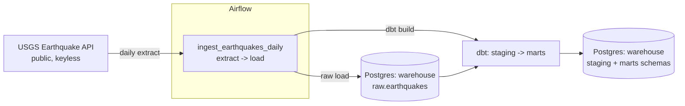

# Airflow + dbt ELT Pipeline

A small, orchestrated ELT pipeline built as a 4-week portfolio project. Apache
Airflow extracts data from a public API and loads it raw into a Postgres
warehouse; dbt then transforms the raw data into clean, tested models.

## Problem

Most portfolio data projects are a single notebook that pulls data and
charts it once. That doesn't demonstrate how data actually gets produced and
kept fresh in a real environment: on a schedule, with retries, with raw data
landed separately from transformed data, and with the transformation layer
tested and documented. This project builds that pipeline end to end, in
layers, over four weeks.

## Architecture



- **Extract**: an Airflow task calls the USGS Earthquake Hazards Program
  GeoJSON feed (no API key required) and pulls the day's earthquake records.
- **Load**: a second task writes those records, close to raw, into a
  `raw.earthquakes` table in a dedicated warehouse Postgres instance, with the
  full source payload kept in a `JSONB` column for lossless reprocessing.
- **Transform**: a third Airflow task runs a dbt project (`include/dbt/earthquake_dbt`)
  against the warehouse. dbt builds a `stg_earthquakes` staging model (cleaned,
  typed, renamed columns, source freshness checks) and three mart models —
  `mart_daily_earthquake_counts`, `mart_magnitude_buckets`, and
  `mart_region_activity` — with schema and data tests on each.

Airflow's own metadata database is a separate Postgres instance from the
warehouse, so orchestration state and warehouse data don't share a database.

## Tech stack

- **Orchestration**: Apache Airflow 2.10 (`LocalExecutor`, no Celery/Redis —
  kept lean for a project this size)
- **Warehouse**: PostgreSQL 16
- **Transformation**: dbt (dbt-core + dbt-postgres)
- **Infra**: Docker Compose
- **Source data**: [USGS Earthquake Hazards Program](https://earthquake.usgs.gov/earthquakes/feed/v1.0/geojson.php) GeoJSON feed — public, no API key

## Project layout

```
.
├── dags/                     # Airflow DAGs
│   └── ingest_earthquakes.py
├── include/                  # SQL, helpers, and the dbt project
│   ├── sql/
│   └── dbt/earthquake_dbt/   # dbt project: staging + mart models
│       ├── models/staging/   # stg_earthquakes + sources.yml
│       └── models/marts/     # daily counts, magnitude buckets, region activity
├── plugins/                  # Airflow plugins (empty for now)
├── logs/                     # Airflow task logs (gitignored, created at runtime)
├── docker-compose.yml
├── .env.example
└── README.md
```

## Running it

1. Copy the env file and start the stack:

   ```bash
   cp .env.example .env
   docker compose up -d
   ```

2. Wait for `airflow-init` to finish (it runs the metadata DB migration and
   creates the default admin user), then open the Airflow UI:

   ```
   http://localhost:8080
   ```

   Login: `admin` / `admin`.

3. The DAG `ingest_earthquakes_daily` runs once a day (extract -> load ->
   dbt `transform`). To run it immediately from the UI, unpause it and click
   the "Trigger DAG" button — or from the CLI:

   ```bash
   docker exec airflow_scheduler airflow dags trigger ingest_earthquakes_daily
   ```

4. Inspect the loaded and transformed data directly (the warehouse Postgres
   is exposed on the host at `localhost:5433`):

   ```bash
   docker exec warehouse_db psql -U warehouse -d warehouse -c "SELECT count(*) FROM raw.earthquakes;"
   docker exec warehouse_db psql -U warehouse -d warehouse -c "SELECT * FROM marts.mart_daily_earthquake_counts ORDER BY event_date;"
   docker exec warehouse_db psql -U warehouse -d warehouse -c "SELECT * FROM marts.mart_magnitude_buckets;"
   docker exec warehouse_db psql -U warehouse -d warehouse -c "SELECT * FROM marts.mart_region_activity ORDER BY earthquake_count DESC LIMIT 10;"
   ```

   You can also run dbt directly, outside of Airflow, from inside any
   Airflow container:

   ```bash
   docker exec airflow_scheduler /home/airflow/dbt-venv/bin/dbt build \
     --project-dir /opt/airflow/include/dbt/earthquake_dbt \
     --profiles-dir /opt/airflow/include/dbt/earthquake_dbt
   ```

   (dbt is installed into its own virtualenv at `/home/airflow/dbt-venv` —
   see the root `Dockerfile` — to avoid dependency conflicts with Airflow's
   own Python environment.)

## Roadmap

- [x] **Week 1 — Foundation**: repo scaffold, Airflow + Postgres via Docker
      Compose, first DAG extracting from a public API and loading raw data
      into the warehouse.
- [x] **Week 2 — Transform, part 1**: add a dbt project against the warehouse,
      staging models over `raw.earthquakes`, source freshness checks. Also
      pulled forward from later weeks: mart-level models (daily counts,
      magnitude buckets, region activity), dbt tests (uniqueness, not-null,
      accepted ranges), and an Airflow task running dbt after the ingest
      (extract -> load -> transform) in the same DAG.
- [ ] **Week 3 — Transform, part 2**: dbt docs site, more test coverage.
- [ ] **Week 4 — Polish**: alerting on failure, final documentation/demo.

## License

MIT — see [LICENSE](LICENSE).
