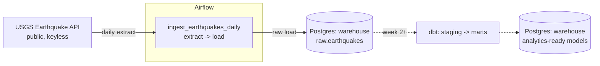

# Airflow + dbt ELT Pipeline

A small, orchestrated ELT pipeline built as a 4-week portfolio project. Apache
Airflow extracts data from a public API and loads it raw into a Postgres
warehouse; dbt then transforms the raw data into clean, tested models.

## Problem

Most portfolio data projects are a single notebook that pulls data and
charts it once. That doesn't demonstrate how data actually gets produced and
kept fresh in a real environment: on a schedule, with retries, with raw data
landed separately from transformed data, and with the transformation layer
tested and documented. This project builds that pipeline end to end, in
layers, over four weeks.

## Architecture



- **Extract**: an Airflow task calls the USGS Earthquake Hazards Program
  GeoJSON feed (no API key required) and pulls the day's earthquake records.
- **Load**: a second task writes those records, close to raw, into a
  `raw.earthquakes` table in a dedicated warehouse Postgres instance, with the
  full source payload kept in a `JSONB` column for lossless reprocessing.
- **Transform** (weeks 2-4): dbt reads from `raw` and builds staging and mart
  models on top, with tests and documentation.

Airflow's own metadata database is a separate Postgres instance from the
warehouse, so orchestration state and warehouse data don't share a database.

## Tech stack

- **Orchestration**: Apache Airflow 2.10 (`LocalExecutor`, no Celery/Redis —
  kept lean for a project this size)
- **Warehouse**: PostgreSQL 16
- **Transformation** (from week 2): dbt
- **Infra**: Docker Compose
- **Source data**: [USGS Earthquake Hazards Program](https://earthquake.usgs.gov/earthquakes/feed/v1.0/geojson.php) GeoJSON feed — public, no API key

## Project layout

```
.
├── dags/                     # Airflow DAGs
│   └── ingest_earthquakes.py
├── include/                  # SQL, helpers, and (later) dbt project
│   └── sql/
├── plugins/                  # Airflow plugins (empty for now)
├── logs/                     # Airflow task logs (gitignored, created at runtime)
├── docker-compose.yml
├── .env.example
└── README.md
```

## Running it

1. Copy the env file and start the stack:

   ```bash
   cp .env.example .env
   docker compose up -d
   ```

2. Wait for `airflow-init` to finish (it runs the metadata DB migration and
   creates the default admin user), then open the Airflow UI:

   ```
   http://localhost:8080
   ```

   Login: `admin` / `admin`.

3. The DAG `ingest_earthquakes_daily` runs once a day. To run it immediately
   from the UI, unpause it and click the "Trigger DAG" button — or from the
   CLI:

   ```bash
   docker exec airflow_scheduler airflow dags trigger ingest_earthquakes_daily
   ```

4. Inspect the loaded data directly (the warehouse Postgres is exposed on the
   host at `localhost:5433`):

   ```bash
   docker exec warehouse_db psql -U warehouse -d warehouse -c "SELECT count(*) FROM raw.earthquakes;"
   ```

## Roadmap

- [x] **Week 1 — Foundation**: repo scaffold, Airflow + Postgres via Docker
      Compose, first DAG extracting from a public API and loading raw data
      into the warehouse.
- [ ] **Week 2 — Transform, part 1**: add a dbt project against the warehouse,
      staging models over `raw.earthquakes`, source freshness checks.
- [ ] **Week 3 — Transform, part 2**: mart-level models (e.g. daily
      aggregates by region/magnitude), dbt tests (uniqueness, not-null,
      accepted ranges), dbt docs.
- [ ] **Week 4 — Polish**: Airflow task to run dbt as part of the same DAG
      (extract -> load -> transform), alerting on failure, and final
      documentation/demo.

## License

MIT — see [LICENSE](LICENSE).
